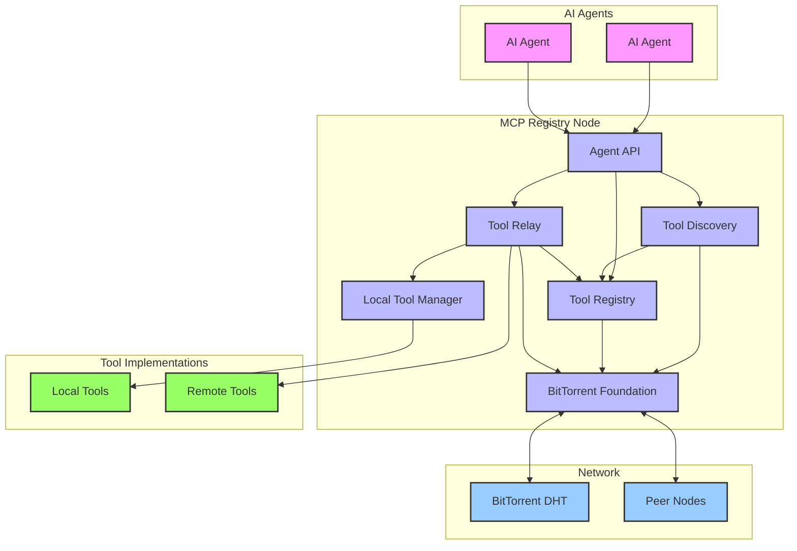

# Decentralized MCP Registry - System Architecture

## Overview
This document describes the high-level system architecture for the decentralized MCP registry, explaining how the core components interact to create a cohesive system. The architecture is built on BitTorrent's P2P protocol stack to provide a robust, scalable, and decentralized solution for tool registration, discovery, and invocation.

## System Architecture Diagram

## Core Components

### BitTorrent Foundation
The BitTorrent Foundation serves as the underlying P2P networking layer that enables decentralized communication, discovery, and data exchange. Key responsibilities include:

- Establishing and maintaining P2P connections between registry nodes
- Providing a distributed hash table (DHT) for decentralized discovery
- Handling NAT traversal for connectivity across network boundaries
- Enabling efficient peer discovery and management
- Providing reliable message passing between nodes

This component is built on a proven, mature protocol stack with built-in solutions for many challenging P2P networking problems.

### Tool Registry
The Tool Registry manages the catalog of available tools, their metadata, and versioning. It serves as the system's knowledge base and provides:

- Local storage of tool definitions with CRUD operations
- Tool metadata management and validation
- Version tracking for tools
- Integration with the DHT for distributed registry features
- Synchronization of registry data between nodes

The registry stores comprehensive information about each tool, including its interface, capabilities, and access requirements.

### Tool Relay
The Tool Relay handles the routing and execution of tool invocation requests, making remote tools appear local to the AI agents. Its responsibilities include:

- Processing incoming tool invocation requests
- Determining optimal routing for requests
- Executing local tool invocations
- Forwarding remote invocations to appropriate nodes
- Managing results and error handling
- Implementing retry and fallback mechanisms

This component creates the seamless experience where AI agents can use tools without knowing their physical location.

### Tool Discovery
The Tool Discovery system allows AI agents to find tools based on capabilities, keywords, or other criteria. It provides:

- Query processing for tool discovery requests
- Capability-based matching and semantic understanding
- Integration with the DHT for network-wide discovery
- Ranking and filtering of discovery results
- Caching and optimization for common queries

This component enables AI agents to dynamically discover tools they weren't previously aware of.

### Local Tool Manager
The Local Tool Manager handles the execution environment for locally installed tools:

- Manages tool installation and configuration
- Provides execution sandboxing for safety
- Monitors resource usage and enforces limits
- Handles local tool lifecycle management
- Implements tool versioning and updates

This component enables running tools directly on the local node for performance and offline availability.

### Agent API
The Agent API provides a unified interface for AI agents to interact with the registry:

- Exposes tool discovery, registry browsing, and invocation capabilities
- Handles authentication and authorization
- Implements rate limiting and quota enforcement
- Provides consistent error handling and logging
- Offers both synchronous and asynchronous operation modes

## Data Flow

### Tool Registration Flow
1. Tool provider registers a tool with its local Tool Registry
2. Tool Registry validates the tool definition and metadata
3. Tool is stored in the local registry database
4. Tool metadata is announced to the DHT via BitTorrent Foundation
5. Other nodes discover the new tool through DHT announcements

### Tool Discovery Flow
1. AI Agent sends a discovery query to its connected registry node
2. Tool Discovery processes the query and checks local registry
3. For network-wide discovery, queries are sent to the DHT
4. Results from local and DHT sources are merged and ranked
5. Consolidated results are returned to the AI Agent

### Tool Invocation Flow
1. AI Agent sends an invocation request for a specific tool
2. Tool Relay validates the request and determines if the tool is local or remote
3. For local tools, the request is forwarded to the Local Tool Manager
4. For remote tools, the request is routed via BitTorrent to the hosting node
5. Results are collected and returned to the AI Agent
6. Optional billing transaction records are created and signed

### Registry Synchronization Flow
1. Registry nodes periodically exchange metadata summaries
2. Differences between registries are identified
3. Missing or outdated tool definitions are requested
4. Tool definitions are transferred using BitTorrent's efficient protocol
5. Received definitions are validated and integrated into the local registry

## Security Architecture

The system implements multiple layers of security:

1. **Cryptographic Identities**
   - Each node has a unique cryptographic identity
   - Tools are signed by their providers
   - Messages and requests are signed by senders

2. **Verification Layers**
   - Tool definitions are verified against their signatures
   - DHT announcements include verification data
   - Request authenticity is verified before processing

3. **Access Controls**
   - Tool providers can specify access requirements
   - Registry nodes can implement local access policies
   - Authorization is checked before tool invocation

4. **Trust Model**
   - Web of trust for node reputation
   - Progressive trust with earned privileges
   - Capability-based security model for tools

## Deployment Architecture

Each registry node is a self-contained application that can be deployed in various environments:

1. **Standalone Mode**
   - Node runs as an independent service
   - Full participation in the P2P network
   - Hosts local tools and relays for remote tools

2. **Tool Provider Mode**
   - Focused on hosting and providing tools
   - Optimized for tool execution performance
   - May host multiple specialized tools

3. **Discovery Hub Mode**
   - Optimized for discovery and routing
   - Maintains extensive registry information
   - May not host tools directly

4. **Integrated Mode**
   - Embedded within an AI agent's environment
   - Provides local tool execution and network connectivity
   - May operate with limited resources

## Scalability and Performance

The architecture addresses scalability and performance through several mechanisms:

1. **Distributed DHT**
   - No central bottleneck for discovery
   - Load distributed across all participating nodes
   - Locality-aware queries for efficiency

2. **Caching Layers**
   - Discovery results caching
   - Registry metadata caching
   - Connection and routing caching

3. **Efficient Tool Routing**
   - Intelligent routing based on network topology
   - Fallback mechanisms for reliability
   - Result caching for frequently used tools

4. **Parallel Operations**
   - Concurrent DHT queries
   - Parallel tool invocations
   - Asynchronous processing model

## Implementation Strategy

The implementation will follow a phased approach:

1. **Phase 1: Core Infrastructure**
   - BitTorrent Foundation integration
   - Basic Tool Registry functionality
   - Simple Tool Relay capabilities
   - Fundamental discovery features

2. **Phase 2: Enhanced Functionality**
   - Security features and access controls
   - Advanced discovery capabilities
   - Local tool execution environment
   - Performance optimizations

3. **Phase 3: Advanced Features**
   - Billing and monetization
   - Advanced reputation system
   - Comprehensive monitoring and metrics
   - Enterprise integration features

## Technology Stack

The implementation will use:

- **Python** as the primary programming language
- **libtorrent** for BitTorrent functionality
- **JSON/MessagePack** for data serialization
- **SQLite/LevelDB** for local storage
- **Cryptography** libraries for security features
- **AsyncIO** for asynchronous processing

## Conclusion

This architecture leverages BitTorrent's mature P2P capabilities to create a robust decentralized registry for MCP tools. By using proven technologies and designing for scalability, security, and performance from the ground up, the system provides a solid foundation for decentralized tool sharing and invocation without central points of failure or control.