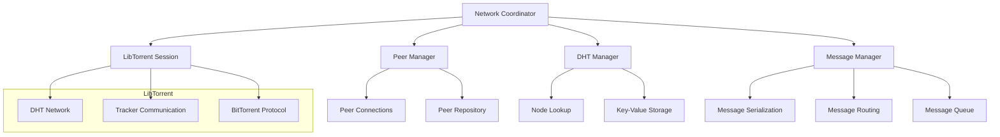

# Design Document: P2P Network Foundation Using BitTorrent Library

## Overview
This document details the design for implementing the P2P network foundation for the decentralized MCP registry using an established BitTorrent library as the core networking layer. By leveraging BitTorrent's mature P2P capabilities, we'll build a reliable and efficient distributed system that inherits the robustness and scalability of the BitTorrent protocol.

## BitTorrent Library Selection

After evaluating available options, we recommend using **libtorrent** (specifically, its Python bindings) as our foundation:

1. **libtorrent** - A feature-complete C++ BitTorrent implementation with Python bindings
   - Comprehensive DHT implementation
   - NAT traversal capabilities
   - Mature, well-tested codebase
   - Active maintenance
   - Extensive documentation

Alternative options considered:
- **py3createtorrent** - Too limited, focuses only on torrent creation
- **Deluge** - Full client rather than a library
- **qBittorrent** - Full client rather than a library
- **Transmission** - Full client rather than a library

## Architecture

### System Components



### Core Components

#### Network Coordinator
- High-level abstraction over the BitTorrent functionality
- Coordinates all P2P networking activities
- Manages the node's identity and network state
- Delegates BitTorrent-specific operations to the LibTorrent Session
- Provides a simplified API for the rest of the system

#### LibTorrent Session
- Wraps the libtorrent session object
- Configures and initializes the BitTorrent engine
- Manages DHT, tracker, and protocol settings
- Handles low-level networking details
- Provides events for connection and DHT activities

#### Peer Manager
- Builds on top of BitTorrent's peer management
- Adds MCP-specific metadata to peers
- Tracks active and known peer connections
- Translates between BitTorrent peers and MCP nodes

#### DHT Manager
- Extends BitTorrent's DHT for MCP-specific needs
- Implements key-value storage for registry data
- Provides node lookup functionality
- Manages DHT bootstrap process

#### Message Manager
- Implements message passing on top of BitTorrent connections
- Handles serialization and deserialization of messages
- Manages message routing and delivery guarantees
- Implements message queueing and retry logic

## Interfaces

### NetworkCoordinator
```python
class NetworkCoordinator:
    def __init__(self, node_id: str, config: NetworkConfig):
        """Initialize the network coordinator with node identity and configuration."""
        
    def start(self) -> None:
        """Start the BitTorrent session and begin participating in the network."""
        
    def stop(self) -> None:
        """Gracefully shut down the BitTorrent session and network components."""
        
    def get_node_id(self) -> str:
        """Get this node's unique identifier."""
        
    def get_dht_status(self) -> DHTStatus:
        """Get current status of the DHT network connection."""
        
    def add_dht_bootstrap_node(self, address: str, port: int) -> None:
        """Add a bootstrap node for DHT network entry."""
        
    def get_peers(self) -> List[PeerInfo]:
        """Get information about currently connected peers."""
        
    def add_message_handler(self, 
                           message_type: str, 
                           handler: Callable[[Message, PeerInfo], None]) -> None:
        """Register a handler for incoming messages of a specific type."""
        
    def send_message(self, peer_id: str, message: Message) -> bool:
        """Send a message to a specific peer."""
        
    def broadcast_message(self, message: Message, 
                         limit: Optional[int] = None) -> int:
        """Broadcast a message to connected peers, returns number of peers messaged."""
        
    def store_value(self, key: str, value: bytes, 
                   ttl: Optional[int] = None) -> bool:
        """Store a value in the DHT."""
        
    def get_value(self, key: str) -> Optional[bytes]:
        """Retrieve a value from the DHT."""
```

### LibTorrentSession
```python
class LibTorrentSession:
    def __init__(self, config: SessionConfig):
        """Initialize the libtorrent session with configuration."""
        
    def start(self) -> None:
        """Start the libtorrent session."""
        
    def stop(self) -> None:
        """Stop the libtorrent session."""
        
    def add_dht_bootstrap_node(self, address: str, port: int) -> None:
        """Add a bootstrap node for the DHT."""
        
    def get_dht_stats(self) -> Dict[str, Any]:
        """Get statistics about the DHT network."""
        
    def add_peer_alert_handler(self, handler: Callable[[PeerAlert], None]) -> None:
        """Add a handler for peer-related alerts."""
        
    def add_dht_alert_handler(self, handler: Callable[[DHTAlert], None]) -> None:
        """Add a handler for DHT-related alerts."""
        
    def get_session_status(self) -> Dict[str, Any]:
        """Get the current status of the libtorrent session."""
```

## Data Models

### NodeIdentity
```python
class NodeIdentity:
    node_id: str               # Unique identifier (derived from public key)
    public_key: bytes          # Public key for cryptographic operations
    private_key: bytes         # Private key (secured)
    created_at: datetime       # When the identity was created
    signature_algorithm: str   # Algorithm used for signatures
    dht_id: bytes              # DHT network identifier (usually same as node_id)
```

### PeerInfo
```python
class PeerInfo:
    peer_id: str               # Unique identifier for the peer
    dht_id: bytes              # DHT network identifier
    addresses: List[str]       # Known addresses for the peer
    port: int                  # Port number
    last_seen: datetime        # When the peer was last active
    connection_status: Status  # Current connection state
    protocol_version: str      # Version of the MCP protocol
    supported_features: List[str] # Features supported by this peer
```

### Message
```python
class Message:
    message_id: str            # Unique message identifier
    message_type: str          # Type of message 
    sender_id: str             # ID of the sending node
    recipient_id: Optional[str] # ID of the intended recipient, if any
    timestamp: datetime        # When the message was created
    payload: bytes             # Message content
    signature: bytes           # Cryptographic signature
    ttl: int                   # Time-to-live for message routing
```

## BitTorrent Integration Details

### DHT Utilization
We will use BitTorrent's Kademlia DHT implementation for:
1. **Peer Discovery** - Finding other MCP registry nodes in the network
2. **Key-Value Storage** - Storing small amounts of data like node capabilities and network state
3. **Distributed Indexing** - Creating a resilient lookup system for tools across the network

### NAT Traversal
We'll leverage BitTorrent's NAT traversal capabilities:
1. **UPnP/NAT-PMP** - For automatic port forwarding on compatible routers
2. **Hole Punching** - For establishing direct connections between peers behind NATs
3. **DHT for Rendezvous** - Using the DHT as a rendezvous point for connection establishment

### Custom Protocol Extension
We'll extend BitTorrent's protocol with:
1. **Custom Message Types** - For MCP-specific communication
2. **Metadata Exchange** - For sharing registry information
3. **Tool Discovery Protocol** - For efficient tool lookup and capability matching

## Implementation Approach
1. Create a thin wrapper around the libtorrent Python bindings
2. Implement the NetworkCoordinator and basic DHT functionality
3. Add peer management and connection handling
4. Implement message passing over BitTorrent connections
5. Add custom DHT extensions for registry data
6. Implement NAT traversal and connection reliability features
7. Add security features (TLS, message signing/verification)

## Using DHT for MCP Registry

BitTorrent's DHT will be used in novel ways to support the MCP registry:

1. **Tool Lookups** - We'll store tool identifiers and their hosting nodes
2. **Capability Advertisements** - Nodes will advertise their tools' capabilities
3. **Network Topology** - The DHT will help build an efficient overlay network
4. **Peer Reputation** - We'll extend the DHT with reputation data about peers

### DHT Key Structure
```
mcp:tools:{tool_id} -> List of nodes hosting the tool
mcp:capabilities:{capability} -> List of tools providing the capability
mcp:nodes:{node_id}:info -> Node information and capabilities
mcp:nodes:{node_id}:reputation -> Node reputation score and history
```

## Security Considerations
- All BitTorrent connections will be encrypted
- Message signing will be implemented on top of BitTorrent protocol
- Node identities will be cryptographically verifiable
- The DHT will be used for a basic web of trust
- Rate limiting will be applied to prevent abuse
- Nodes will validate all received messages and DHT data

## Dependencies
- libtorrent (1.2.x or later) with Python bindings
- Cryptography library for message signing/verification
- Serialization library (e.g., MessagePack or Protocol Buffers)
- Network utilities for diagnostics and monitoring

## Testing Strategy
- Unit tests for all component classes
- Integration tests with actual libtorrent instances
- Simulation tests with multiple virtual nodes
- NAT traversal tests in various network configurations
- Performance tests for message routing and DHT operations

## Open Questions
1. How should we handle BitTorrent's tendency to create many connections?
2. What's the optimal DHT configuration for our expected network size?
3. How should we handle BitTorrent library versioning and compatibility?
4. What mechanisms should we implement for handling malicious peers?