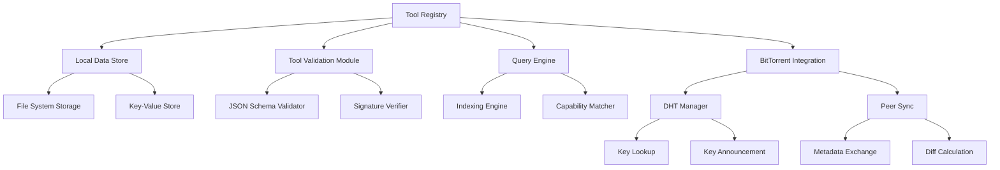

# Design Document: Tool Registry with BitTorrent Integration

## Overview
This document details the design for implementing the Tool Registry component of the decentralized MCP registry. The Tool Registry is responsible for storing, managing, and retrieving tool definitions within each node. This design specifically integrates with the BitTorrent P2P foundation to leverage its distributed capabilities for registry synchronization and discovery.

## Architecture

### Components



### Core Components

#### Tool Registry
- Provides main API for tool registration and discovery
- Orchestrates interactions between subcomponents
- Manages tool metadata and versioning
- Enforces access controls and validation rules

#### Local Data Store
- Persists tool definitions and metadata
- Handles data serialization and deserialization
- Implements efficient storage and retrieval
- Maintains consistency and durability guarantees

#### Tool Validation Module
- Validates tool definitions against schema
- Verifies required fields and data types
- Checks for interface consistency
- Validates version information and signatures

#### Query Engine
- Implements efficient searching and filtering
- Supports querying by name, description, and capability
- Provides ranked results for capability-based queries
- Manages indices for performance optimization

#### BitTorrent Integration
- Connects the registry to BitTorrent DHT functionality
- Announces tool availability on the DHT
- Discovers remote tools through DHT lookups
- Synchronizes registry data with peers
- Uses BitTorrent's metadata protocol for exchanging tool definitions

## Interfaces

### ToolRegistry
```python
class ToolRegistry:
    def __init__(self, config: RegistryConfig, network_coordinator: NetworkCoordinator):
        """Initialize the tool registry with configuration and BitTorrent network access."""
        
    def register_tool(self, tool_definition: ToolDefinition) -> str:
        """Register a new tool or update an existing one, returns tool_id."""
        
    def get_tool(self, tool_id: str) -> Optional[ToolDefinition]:
        """Retrieve a tool definition by its ID."""
        
    def remove_tool(self, tool_id: str) -> bool:
        """Remove a tool from the registry."""
        
    def list_tools(self, filters: Optional[Dict] = None) -> List[ToolSummary]:
        """List all tools, optionally filtered."""
        
    def search_tools(self, query: str, 
                    capability: Optional[str] = None) -> List[ToolSummary]:
        """Search for tools by query string and/or capability."""
        
    def get_tool_versions(self, tool_name: str) -> List[VersionInfo]:
        """Get all available versions of a tool."""
        
    def announce_tools(self) -> int:
        """Announce available tools to the DHT, returns number of tools announced."""
        
    def discover_tools(self, query: Optional[str] = None, 
                      capability: Optional[str] = None) -> List[RemoteToolInfo]:
        """Discover tools available on remote nodes using DHT."""
        
    def sync_with_peer(self, peer_id: str) -> SyncResult:
        """Synchronize registry data with a specific peer."""
```

### LocalDataStore
```python
class LocalDataStore:
    def __init__(self, storage_path: str):
        """Initialize the data store at the specified location."""
        
    def save(self, tool_id: str, tool_definition: Dict) -> bool:
        """Save a tool definition to storage."""
        
    def load(self, tool_id: str) -> Optional[Dict]:
        """Load a tool definition from storage."""
        
    def delete(self, tool_id: str) -> bool:
        """Delete a tool definition from storage."""
        
    def list_all(self) -> List[str]:
        """List all tool IDs in storage."""
        
    def get_metadata(self, tool_id: str) -> Optional[ToolMetadata]:
        """Get metadata for a tool without loading the full definition."""
        
    def get_changes_since(self, timestamp: datetime) -> Dict[str, ChangeType]:
        """Get changes since a specific time."""
        
    def calculate_registry_hash(self) -> str:
        """Calculate a hash of the entire registry for comparison."""
```

### BitTorrentRegistryIntegration
```python
class BitTorrentRegistryIntegration:
    def __init__(self, network_coordinator: NetworkCoordinator):
        """Initialize with access to the BitTorrent network layer."""
        
    def announce_tool(self, tool_id: str, metadata: ToolMetadata) -> bool:
        """Announce a tool's availability in the DHT."""
        
    def lookup_tool(self, tool_id: str) -> List[PeerToolInfo]:
        """Look up peers offering a specific tool."""
        
    def announce_capability(self, capability: str, tool_ids: List[str]) -> bool:
        """Announce tools providing a specific capability."""
        
    def lookup_capability(self, capability: str) -> Dict[str, List[str]]:
        """Look up tools providing a specific capability."""
        
    def get_peer_registry_info(self, peer_id: str) -> Optional[RegistryInfo]:
        """Get information about a peer's registry."""
        
    def request_tool_sync(self, peer_id: str, 
                         tool_ids: Optional[List[str]] = None) -> SyncSession:
        """Request synchronization of specific tools with a peer."""
        
    def handle_sync_request(self, request: SyncRequest) -> SyncResponse:
        """Handle an incoming synchronization request."""
```

## Data Models

### ToolDefinition
```python
class ToolDefinition:
    tool_id: str                 # Unique identifier for the tool
    name: str                    # Human-readable name
    description: str             # Detailed description
    version: str                 # Semantic version (SemVer)
    provider_id: str             # ID of the tool provider
    capabilities: List[str]      # List of capabilities provided
    input_schema: JSONSchema     # JSON Schema for input
    output_schema: JSONSchema    # JSON Schema for output
    documentation_url: str       # Link to documentation
    created_at: datetime         # Creation timestamp
    updated_at: datetime         # Last update timestamp
    signature: bytes             # Provider's signature
    metadata: Dict[str, Any]     # Additional metadata
```

### ToolSummary
```python
class ToolSummary:
    tool_id: str                 # Unique identifier for the tool
    name: str                    # Human-readable name
    version: str                 # Semantic version (SemVer)
    provider_id: str             # ID of the tool provider
    description: str             # Short description
    capabilities: List[str]      # List of capabilities provided
    updated_at: datetime         # Last update timestamp
```

### RemoteToolInfo
```python
class RemoteToolInfo:
    tool_id: str                 # Unique identifier for the tool
    name: str                    # Human-readable name
    version: str                 # Semantic version
    provider_id: str             # ID of the tool provider
    capabilities: List[str]      # List of capabilities
    hosting_peers: List[PeerInfo] # Peers hosting this tool
    popularity: int              # Number of peers hosting this tool
    last_updated: datetime       # Last known update time
```

## BitTorrent DHT Integration

### DHT Key Structure
The BitTorrent DHT will be used to store and retrieve registry information:

```
mcp:registry:tool:{tool_id}               -> JSON with basic tool info and hosting peers
mcp:registry:capability:{capability}       -> JSON with tools providing capability
mcp:registry:provider:{provider_id}:tools  -> JSON with tools from specific provider
mcp:registry:node:{node_id}:summary        -> JSON with node's registry summary
```

### Metadata Protocol
We'll extend BitTorrent's metadata exchange protocol (BEP 9) to support registry synchronization:

1. **Handshake Phase**
   - Peer A requests registry info from Peer B
   - Peer B responds with registry hash and tool count
   - Peer A compares with local registry

2. **Difference Detection Phase**
   - Peer A requests tool list with timestamps
   - Peer B sends summarized tool list
   - Peer A determines which tools are different

3. **Synchronization Phase**
   - Peer A requests specific tool definitions
   - Peer B sends requested definitions
   - Peer A validates and integrates received tools

## Storage Design
The Tool Registry will use a hybrid storage approach:

1. **Primary Storage**: Simple file system storage for initial implementation
   - Each tool definition stored as a separate JSON file
   - Directory structure based on tool IDs
   - Simple to implement and debug

2. **Future Enhancement**: Key-value store for better performance
   - Faster lookups and better concurrency
   - Atomic operations for consistency
   - Better scalability for large registries

### Directory Structure
```
/registry/
  /tools/
    /{tool_id}.json           # Current version of the tool
  /index/
    /by_name.idx              # Name-based index
    /by_capability.idx        # Capability-based index
  /sync/
    /peer_{peer_id}.json      # Peer sync state
    /announcements.json       # DHT announcement status
```

## Integration with BitTorrent P2P Layer

### Tool Announcement
1. When tools are registered, their metadata is announced to the DHT
2. Announcements include tool ID, name, version, and capabilities
3. Announcements have a TTL and are refreshed periodically
4. Multiple announcement keys are used for different lookup patterns

### Tool Discovery
1. To find tools, clients query the DHT using appropriate keys
2. DHT returns peers that have announced matching tools
3. Tool metadata can be retrieved directly from those peers
4. Results from multiple peers are merged and deduplicated

### Registry Synchronization
1. Peers periodically exchange registry summaries
2. Differences are identified through comparing tool versions and hashes
3. Missing or outdated tools are requested and transferred
4. BitTorrent's efficient transfer protocol handles the data exchange
5. All transferred tools are validated before being added to the registry

## Implementation Approach
1. Implement basic LocalDataStore with file-based storage
2. Add schema validation for tool definitions
3. Implement core ToolRegistry API
4. Add indexing for efficient querying
5. Integrate with BitTorrent DHT for tool announcements
6. Implement tool discovery via DHT
7. Add registry synchronization using BitTorrent's metadata protocol
8. Implement signature validation for security

## Security Considerations
- All tool definitions will be cryptographically signed by providers
- Signature validation will be performed on registration and retrieval
- DHT announcements will include signature verification data
- Tool synchronization will validate all incoming tool definitions
- Access controls will be enforced for local tool registration

## Performance Considerations
- DHT lookups will be cached to minimize network traffic
- Registry synchronization will transfer only differences
- Parallel requests will be used for multi-peer discovery
- Local indices will optimize search performance
- Tool definitions will be stored in an efficient format

## Dependencies
- BitTorrent P2P foundation (via NetworkCoordinator)
- JSON Schema validation library
- Cryptography library for signature verification
- Serialization library compatible with BitTorrent

## Testing Strategy
- Unit tests for all component classes
- Integration tests with mocked BitTorrent layer
- End-to-end tests with actual BitTorrent nodes
- Performance tests for discovery and synchronization
- Security tests for signature verification

## Open Questions
1. How should we handle different versions of the same tool in the DHT?
2. What's the optimal DHT key structure for efficient discovery?
3. How should we handle conflicts during synchronization?
4. What size limitations should we impose on tool definitions?
5. How do we ensure DHT announcements are secure and authentic?