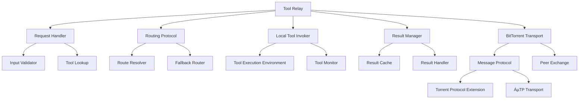
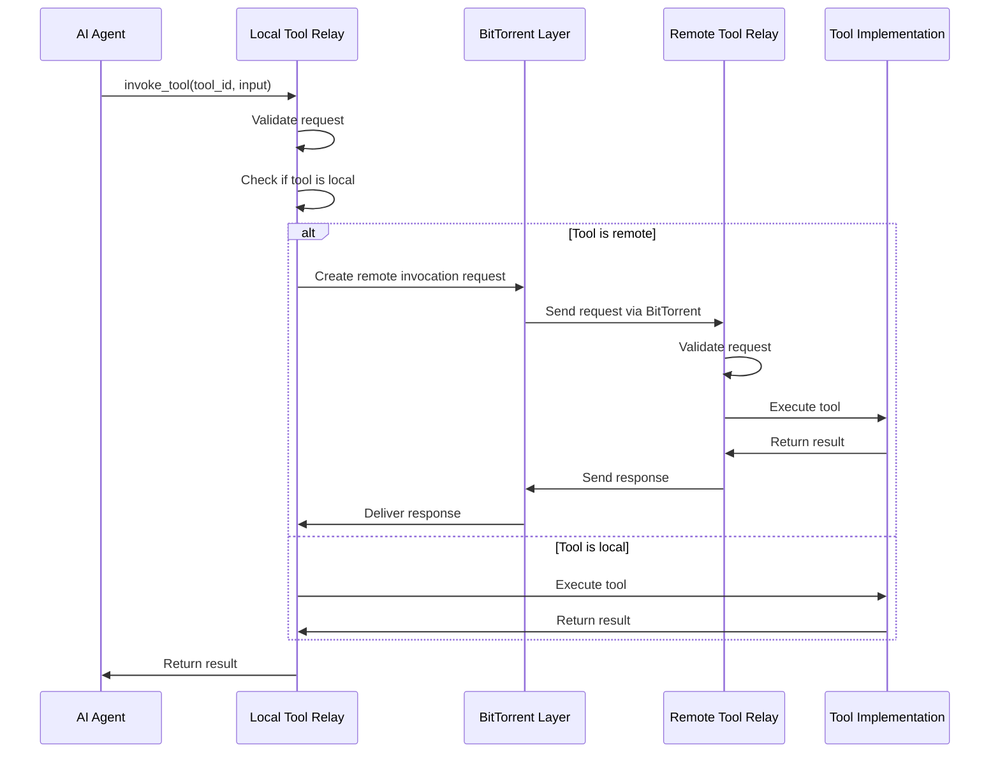

# Design Document: Tool Relay with BitTorrent Integration

## Overview
This document details the design for implementing the Tool Relay component of the decentralized MCP registry. The Tool Relay is responsible for routing tool invocation requests from AI agents to the appropriate tool providers, whether local or remote, and returning results transparently. This design integrates with the BitTorrent P2P foundation to enable efficient and reliable communication between nodes.

## Architecture

### Components



### Core Components

#### Tool Relay
- Main entry point for all tool invocation requests
- Manages the routing and execution of tool requests
- Coordinates with the BitTorrent layer for remote communication
- Handles request lifecycle from submission to result delivery
- Provides a unified interface for both local and remote tools

#### Request Handler
- Validates incoming requests against tool schemas
- Performs initial tool lookup to determine routing
- Handles authentication and authorization
- Prepares requests for local execution or remote routing
- Implements request rate limiting and prioritization

#### Routing Protocol
- Determines optimal route for tool invocation requests
- Manages routing tables based on network topology
- Implements fallback strategies for unreachable nodes
- Optimizes routes based on latency and reliability metrics
- Handles route discovery for unknown tools

#### Local Tool Invoker
- Executes tool invocations on the local node
- Manages tool execution environment and sandboxing
- Monitors tool execution for timeout and resource usage
- Captures and processes tool execution results
- Handles error conditions and logging

#### Result Manager
- Processes and formats tool execution results
- Implements result caching for frequently used invocations
- Manages asynchronous result delivery
- Handles result compression and batching
- Provides result tracking and lookup

#### BitTorrent Transport
- Leverages BitTorrent's peer-to-peer communication
- Implements message passing over BitTorrent connections
- Utilizes BitTorrent's NAT traversal capabilities
- Handles connection management and retry logic
- Provides reliable message delivery guarantees

## Interfaces

### ToolRelay
```python
class ToolRelay:
    def __init__(self, registry: ToolRegistry, network_coordinator: NetworkCoordinator):
        """Initialize the tool relay with registry and network access."""
        
    def invoke_tool(self, tool_id: str, input_data: Dict, 
                  options: Optional[InvocationOptions] = None) -> InvocationResult:
        """Invoke a tool with the provided input data, handle routing automatically."""
        
    def invoke_tool_async(self, tool_id: str, input_data: Dict,
                        callback: Callable[[InvocationResult], None],
                        options: Optional[InvocationOptions] = None) -> str:
        """Asynchronously invoke a tool, returns invocation_id."""
        
    def get_invocation_status(self, invocation_id: str) -> InvocationStatus:
        """Get the current status of an asynchronous invocation."""
        
    def cancel_invocation(self, invocation_id: str) -> bool:
        """Attempt to cancel an ongoing invocation."""
        
    def add_local_tool_handler(self, tool_id: str, 
                             handler: Callable[[Dict], Dict]) -> None:
        """Register a handler for a local tool implementation."""
        
    def remove_local_tool_handler(self, tool_id: str) -> bool:
        """Remove a previously registered local tool handler."""
        
    def get_routing_metrics(self) -> Dict[str, RoutingMetrics]:
        """Get performance metrics for tool routing."""
```

### RequestHandler
```python
class RequestHandler:
    def __init__(self, registry: ToolRegistry):
        """Initialize with access to the tool registry."""
        
    def validate_request(self, tool_id: str, input_data: Dict) -> ValidationResult:
        """Validate an incoming request against the tool's schema."""
        
    def prepare_request(self, tool_id: str, input_data: Dict, 
                       options: InvocationOptions) -> PreparedRequest:
        """Prepare a request for execution or routing."""
        
    def handle_request(self, request: PreparedRequest) -> InvocationResult:
        """Process a request through the appropriate route."""
        
    def check_authorization(self, tool_id: str, 
                          requester_id: str) -> AuthorizationResult:
        """Check if the requester is authorized to use the tool."""
```

### BitTorrentTransport
```python
class BitTorrentTransport:
    def __init__(self, network_coordinator: NetworkCoordinator):
        """Initialize with access to BitTorrent networking."""
        
    def send_invocation_request(self, peer_id: str, request: 
                               RemoteInvocationRequest) -> ResponsePromise:
        """Send a tool invocation request to a remote peer."""
        
    def broadcast_tool_lookup(self, tool_id: str, 
                            max_responses: int = 5) -> List[ToolLocation]:
        """Broadcast a request to locate a specific tool."""
        
    def register_request_handler(self, 
                               handler: Callable[[RemoteInvocationRequest], 
                                               RemoteInvocationResponse]) -> None:
        """Register a handler for incoming remote invocation requests."""
        
    def get_connection_status(self, peer_id: str) -> ConnectionStatus:
        """Get the status of the connection to a specific peer."""
```

## Data Models

### InvocationRequest
```python
class InvocationRequest:
    request_id: str             # Unique identifier for the request
    tool_id: str                # ID of the tool to invoke
    input_data: Dict            # Input parameters for the tool
    requester_id: str           # ID of the requesting entity
    timestamp: datetime         # When the request was created
    timeout: Optional[int]      # Maximum execution time in milliseconds
    priority: RequestPriority   # Priority level for execution
    authentication: Optional[Dict] # Authentication credentials if required
```

### InvocationResult
```python
class InvocationResult:
    request_id: str             # ID of the original request
    status: InvocationStatus    # Status of the invocation
    result_data: Optional[Dict] # Output data if successful
    error: Optional[ErrorInfo]  # Error information if failed
    execution_time: int         # Time taken to execute in milliseconds
    tool_id: str                # ID of the tool that was invoked
    executed_by: str            # ID of the node that executed the tool
    timestamp: datetime         # When the result was generated
```

### RemoteInvocationRequest
```python
class RemoteInvocationRequest:
    request_id: str             # Unique identifier for the request
    tool_id: str                # ID of the tool to invoke
    input_data: Dict            # Input parameters for the tool
    requester_id: str           # ID of the requesting entity
    sender_id: str              # ID of the sending node (may be different from requester)
    route_path: List[str]       # Path the request has taken so far
    timestamp: datetime         # When the request was created
    ttl: int                    # Time-to-live for routing
    timeout: Optional[int]      # Maximum execution time
    signature: bytes            # Cryptographic signature
```

### RoutingTable
```python
class RoutingTable:
    tool_routes: Dict[str, List[RouteInfo]]  # Routes indexed by tool_id
    node_metrics: Dict[str, NodeMetrics]     # Performance metrics for nodes
    last_updated: datetime                   # When the table was last updated
    
    class RouteInfo:
        node_id: str                         # ID of the hosting node
        distance: int                        # Network distance (hops)
        latency: int                         # Average latency in milliseconds
        reliability: float                   # Reliability score (0.0-1.0)
        last_success: Optional[datetime]     # Last successful invocation
```

## BitTorrent Protocol Integration

### Message Protocol Extension
We'll extend BitTorrent's protocol with a custom extension for tool invocation:

1. **Extension Handshake**
   - When peers connect, they exchange capabilities including tool relay support
   - Peers negotiate protocol version and features
   - Connection parameters like maximum message size are established

2. **Message Types**
   - `tool_invocation_request`: Send a request to invoke a tool
   - `tool_invocation_response`: Return the result of a tool invocation
   - `tool_lookup_request`: Ask if a peer has a specific tool
   - `tool_lookup_response`: Respond with tool availability
   - `invocation_status_request`: Query the status of an ongoing invocation
   - `invocation_status_response`: Report on invocation status

3. **Message Format**
   ```
   {
     "msg_type": "tool_invocation_request",
     "msg_id": "unique-message-id",
     "payload": {
       // RemoteInvocationRequest fields serialized
     },
     "signature": "cryptographic-signature"
   }
   ```

### BitTorrent Transport Mechanics
1. **Connection Reuse**
   - We'll reuse existing BitTorrent connections for tool relay messages
   - This leverages BitTorrent's NAT traversal and connection management

2. **Reliable Delivery**
   - Tool invocation uses reliable message delivery with acknowledgments
   - Failed deliveries trigger retries up to a configured limit
   - BitTorrent's µTP (micro Transport Protocol) ensures reliability

3. **Flow Control**
   - Message rate limiting prevents network congestion
   - Backpressure mechanisms handle overload conditions
   - Priority queuing ensures important messages are delivered first

## Routing Mechanics

### Direct Routing
For tools with known locations:
1. Tool Registry provides the hosting node information
2. Request is sent directly to the hosting node via BitTorrent
3. Result is returned directly to the requester

### DHT-Based Routing
For tools with unknown locations:
1. Query the BitTorrent DHT for nodes hosting the tool
2. Select the best node based on network proximity and load
3. Send the request to the selected node
4. Update routing table with new information

### Fallback Routing
When direct routing fails:
1. Try alternative nodes from the routing table
2. If no alternatives, broadcast a tool lookup request
3. Select from respondents and try again
4. If still failing, return an error to the requester

## Invocation Flow



## Implementation Approach
1. Implement basic RequestHandler with request validation
2. Add local tool invocation support
3. Implement BitTorrent message protocol extension
4. Add routing logic for remote tool invocation
5. Implement result handling and caching
6. Add asynchronous invocation support
7. Implement metrics and monitoring
8. Add security features including request signing and verification

## Security Considerations
- All invocation requests will be cryptographically signed
- Authentication will be verified before tool execution
- Request validation will prevent malformed inputs
- Rate limiting will prevent DoS attacks
- Access controls will restrict tool usage
- Execution sandboxing will limit tool capabilities
- Routing paths will be verified to prevent spoofing

## Performance Considerations
- Caching frequently used results to reduce latency
- Intelligent routing to minimize network hops
- Connection pooling to reduce connection overhead
- Request batching to improve throughput
- Asynchronous processing for non-blocking operations
- Timeout mechanisms to prevent hanging requests
- Load balancing across multiple instances of the same tool

## Dependencies
- BitTorrent P2P foundation (via NetworkCoordinator)
- Tool Registry for tool lookup and validation
- JSON Schema validation library
- Cryptography library for request signing/verification
- Serialization library compatible with BitTorrent

## Testing Strategy
- Unit tests for all component classes
- Integration tests with mocked BitTorrent layer
- End-to-end tests with actual BitTorrent nodes
- Performance tests for routing and invocation
- Stress tests with high concurrency
- Security tests for authentication and authorization
- Failure scenario tests for error handling

## Open Questions
1. How should we handle long-running tool invocations?
2. What's the optimal routing strategy for the expected network topology?
3. How should we handle version compatibility for tools?
4. What retry policies should be implemented for failed invocations?
5. How do we ensure fair allocation of resources across multiple requests?