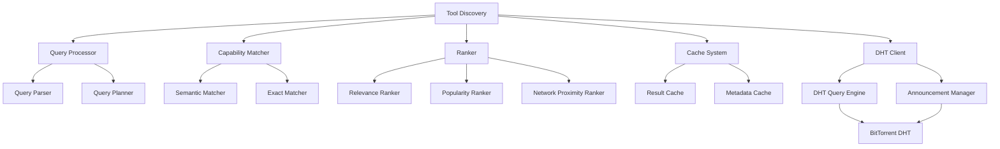

# Design Document: Tool Discovery with BitTorrent Integration

## Overview
This document details the design for implementing the Tool Discovery component of the decentralized MCP registry. The Tool Discovery mechanism allows AI agents to find and learn about available tools across the network without prior knowledge of their existence or location. By leveraging BitTorrent's DHT capabilities, the system provides efficient, scalable, and resilient discovery of tools based on various criteria.

## Architecture

### Components



### Core Components

#### Tool Discovery
- Provides main API for discovering tools across the network
- Orchestrates interactions between subcomponents
- Manages the discovery lifecycle from query to results
- Handles integration with other registry components
- Provides results filtering and transformation

#### Query Processor
- Parses and normalizes discovery queries
- Formulates efficient query plans
- Splits complex queries into simpler subqueries
- Determines optimal query execution strategy
- Merges results from different sources

#### Capability Matcher
- Implements semantic matching for capability descriptions
- Handles exact and fuzzy matching of capabilities
- Normalizes capability expressions for comparison
- Ranks matches by relevance and confidence
- Expands capabilities into related concepts

#### Ranker
- Orders discovery results by relevance
- Considers multiple ranking factors
- Implements customizable ranking algorithms
- Provides result scoring and filtering
- Optimizes for user preferences

#### Cache System
- Caches discovery results to reduce latency
- Manages metadata for fast lookups
- Implements cache invalidation policies
- Provides query-dependent caching
- Optimizes cache usage based on frequency

#### DHT Client
- Interfaces with BitTorrent DHT for distributed discovery
- Manages tool announcements and lookups
- Handles DHT-specific error conditions
- Optimizes DHT queries for efficiency
- Provides abstraction over DHT implementation details

## Interfaces

### ToolDiscovery
```python
class ToolDiscovery:
    def __init__(self, registry: ToolRegistry, network_coordinator: NetworkCoordinator):
        """Initialize with access to registry and BitTorrent network."""
        
    def discover_tools(self, query: Optional[str] = None, 
                     capability: Optional[str] = None,
                     filters: Optional[Dict] = None,
                     options: Optional[DiscoveryOptions] = None) -> List[ToolInfo]:
        """Discover tools matching the query and/or capability."""
        
    def discover_capabilities(self) -> List[CapabilityInfo]:
        """Discover all available capabilities across the network."""
        
    def get_tool_details(self, tool_id: str) -> Optional[ToolDetails]:
        """Get detailed information about a specific tool."""
        
    def discover_tools_by_provider(self, provider_id: str) -> List[ToolInfo]:
        """Discover tools from a specific provider."""
        
    def discover_related_tools(self, tool_id: str) -> List[ToolInfo]:
        """Discover tools related to a specific tool."""
        
    def refresh_discovery_cache(self) -> None:
        """Refresh cached discovery information."""
        
    def get_discovery_metrics(self) -> DiscoveryMetrics:
        """Get metrics about discovery operations."""
```

### QueryProcessor
```python
class QueryProcessor:
    def __init__(self):
        """Initialize the query processor."""
        
    def parse_query(self, query: str) -> ParsedQuery:
        """Parse a discovery query into structured components."""
        
    def create_query_plan(self, parsed_query: ParsedQuery) -> QueryPlan:
        """Create an execution plan for a parsed query."""
        
    def execute_query_plan(self, plan: QueryPlan, 
                         contexts: QueryContexts) -> QueryResults:
        """Execute a query plan and return results."""
        
    def normalize_query(self, query: str) -> str:
        """Normalize a query string for consistency."""
```

### DHTClient
```python
class DHTClient:
    def __init__(self, network_coordinator: NetworkCoordinator):
        """Initialize with access to BitTorrent network."""
        
    def lookup_tool(self, tool_id: str) -> List[ToolAnnouncement]:
        """Look up tool announcements in the DHT."""
        
    def lookup_tools_by_capability(self, capability: str) -> List[ToolAnnouncement]:
        """Look up tools providing a specific capability."""
        
    def lookup_capabilities(self) -> List[CapabilityAnnouncement]:
        """Look up all announced capabilities."""
        
    def announce_tool(self, tool_id: str, metadata: ToolMetadata) -> bool:
        """Announce a tool to the DHT."""
        
    def announce_capability(self, capability: str, 
                          tool_ids: List[str]) -> bool:
        """Announce a capability provided by tools."""
        
    def get_announcement_status(self) -> Dict[str, AnnouncementStatus]:
        """Get status of current announcements."""
```

## Data Models

### DiscoveryQuery
```python
class DiscoveryQuery:
    text: Optional[str]           # Free-text search query
    capabilities: List[str]        # Required capabilities
    tags: List[str]                # Required tags
    provider_id: Optional[str]     # Specific provider
    min_version: Optional[str]     # Minimum version requirement
    max_results: int              # Maximum number of results
    include_experimental: bool    # Whether to include experimental tools
    network_scope: NetworkScope   # How widely to search the network
```

### ToolInfo
```python
class ToolInfo:
    tool_id: str                 # Unique identifier for the tool
    name: str                    # Human-readable name
    description: str             # Short description
    version: str                 # Semantic version (SemVer)
    provider_id: str             # ID of the tool provider
    capabilities: List[str]      # List of capabilities provided
    hosting_nodes: List[str]     # Nodes hosting this tool
    relevance_score: float       # Relevance to the query (0.0-1.0)
    popularity: int              # Popularity metric
    last_updated: datetime       # When the tool was last updated
```

### CapabilityInfo
```python
class CapabilityInfo:
    name: str                    # Capability name
    description: Optional[str]   # Human-readable description
    tool_count: int              # Number of tools providing this capability
    related_capabilities: List[str] # Related or similar capabilities
    popularity: int              # Usage popularity metric
```

### ToolAnnouncement
```python
class ToolAnnouncement:
    tool_id: str                 # Unique identifier for the tool
    name: str                    # Tool name
    version: str                 # Tool version
    capabilities: List[str]      # Provided capabilities
    node_id: str                 # Announcing node
    timestamp: datetime          # Announcement time
    expires: datetime            # Expiration time
    signature: bytes             # Signature of the announcing node
```

## BitTorrent DHT Integration

### DHT Key Structure
We'll use BitTorrent's DHT to store and retrieve discovery information with these key patterns:

```
mcp:discovery:tool:{tool_id}               -> JSON with basic tool info
mcp:discovery:capability:{capability}       -> JSON with tools providing capability
mcp:discovery:provider:{provider_id}        -> JSON with provider's tools
mcp:discovery:keyword:{keyword}             -> JSON with tools matching keyword
mcp:discovery:meta:capabilities             -> JSON with all known capabilities
```

### Announcement Protocol
Tool announcements in the DHT follow this process:

1. **Generating Announcements**
   - Tool metadata is extracted from the registry
   - Announcements are created for tool ID, capabilities, and keywords
   - Each announcement includes a timestamp, expiration, and signature

2. **Publishing to DHT**
   - Announcements are published to appropriate DHT keys
   - For redundancy, multiple keys may be used
   - Announcements have a TTL and are refreshed periodically

3. **Refreshing Announcements**
   - A background process refreshes announcements before expiration
   - Changes in tool metadata trigger immediate updates
   - Removed tools have their announcements explicitly withdrawn

### Discovery Protocol
Tool discovery using the DHT involves:

1. **Query Planning**
   - Based on the discovery parameters, determine which DHT keys to query
   - Plan parallel queries for efficiency
   - Set appropriate timeout and retry parameters

2. **DHT Lookup**
   - Execute DHT lookups for relevant keys
   - Process responses as they arrive
   - Handle timeouts and errors with fallback strategies

3. **Merging Results**
   - Combine results from multiple DHT lookups
   - Deduplicate tools appearing in multiple results
   - Validate tool announcements before including in results

4. **Result Enhancement**
   - For high-relevance results, fetch additional details directly from hosting nodes
   - Enrich results with locally available information
   - Calculate normalized relevance scores

## Discovery Methods

### Keyword-Based Discovery
For free text queries:
1. Parse query into keywords
2. For each keyword, query the corresponding DHT key
3. Merge and rank results based on keyword matches and metadata
4. Apply post-filtering based on other criteria

### Capability-Based Discovery
For capability requirements:
1. Normalize capability expression
2. Query the DHT for the capability key
3. For capability combinations, execute multiple queries
4. Apply set operations (AND, OR) on the result sets
5. Rank results based on capability match quality

### Provider-Based Discovery
For discovering tools from specific providers:
1. Query the DHT for the provider's key
2. Validate provider identity using signatures
3. Rank results based on version and popularity

### Hybrid Discovery
For combined discovery criteria:
1. Execute separate queries for each criterion
2. Apply weighted merging of results
3. Calculate composite relevance scores
4. Filter and sort by composite criteria

## Implementation Approach
1. Implement basic DHTClient for BitTorrent DHT interaction
2. Add simple keyword-based discovery functionality
3. Implement capability-based discovery
4. Add result caching and ranking
5. Implement query processing and planning
6. Add announcement protocols for publishing tools
7. Implement advanced discovery methods
8. Add metrics and monitoring

## Security Considerations
- All DHT announcements will be signed to prevent spoofing
- Announcement signatures will be verified before trusting results
- DHT values will include publication timestamps to prevent replay attacks
- Local blocklists can filter out known malicious nodes
- Reputation scores will influence result ranking
- Rate limiting will prevent DHT flooding

## Performance Considerations
- Caching of discovery results to reduce DHT lookups
- Parallel DHT queries for faster response times
- Query planning to minimize network operations
- Result prefetching for common queries
- Background refreshing of popular query results
- Adaptive timeouts based on network conditions
- Local indices for frequently used discovery patterns

## Dependencies
- BitTorrent P2P foundation (via NetworkCoordinator)
- Tool Registry for local tool information
- Cryptography library for signature verification
- Text processing library for query parsing
- Serialization library compatible with BitTorrent DHT

## Testing Strategy
- Unit tests for all component classes
- Integration tests with mocked DHT
- End-to-end tests with real BitTorrent DHT
- Performance tests with varying network sizes
- Load tests with concurrent discovery operations
- Security tests for announcement verification
- Edge case tests with malformed queries

## Open Questions
1. What's the optimal caching strategy for discovery results?
2. How should we handle capability matching across different naming conventions?
3. What ranking algorithm will provide the most relevant results?
4. How can we mitigate DHT pollution attacks?
5. What's the right balance between local and network discovery?