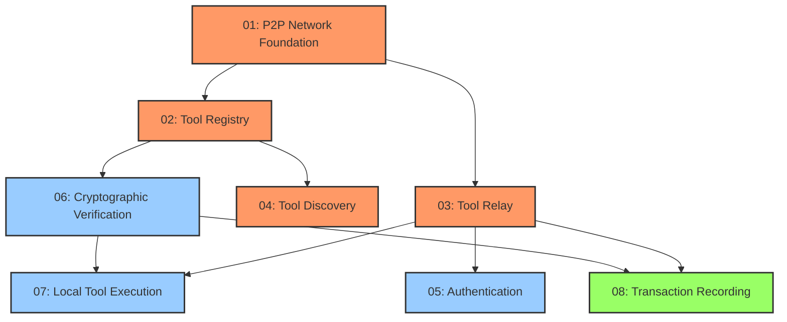

# User Story Priorities and Schedule

This document outlines the implementation priorities for the decentralized MCP registry user stories, providing a clear roadmap for development.

## Priority Matrix

| ID | User Story | Priority | Story Points | Phase | Reasoning |
|----|------------|----------|--------------|-------|-----------|
| 01 | P2P Network Foundation | Critical | 8 | 1 | Foundation for all network communication; nothing works without it. Must be implemented first as all other stories depend on it. |
| 02 | Tool Registry | Critical | 5 | 1 | Core data model and storage. Required for both tool providers and consumers to have any functionality. |
| 03 | Tool Relay | Critical | 6 | 1 | Essential mechanism for the main use case - invoking tools across the network. Without this, the system provides no tangible value. |
| 04 | Tool Discovery | High | 5 | 1 | Necessary for agents to find available tools. Completes the minimal viable product for basic functionality. |
| 05 | Simple Authentication | Medium | 4 | 2 | Important security feature but can initially be implemented with a simple mechanism. Can be enhanced later. |
| 06 | Cryptographic Verification | High | 5 | 2 | Critical for security and trust but can be implemented after basic functionality is working. Sets foundation for trust model. |
| 07 | Local Tool Execution | Medium | 7 | 2 | Enhances performance and enables offline usage, but not required for the core P2P functionality. More complex implementation. |
| 08 | Transaction Recording | Medium | 6 | 3 | Monetization feature that can be added after core functionality is stable. Important for long-term sustainability. |

## Implementation Phases

### Phase 1: Core Functionality (MVP)
**Goal**: Create a functional tool registry with basic P2P capabilities
**Timeline**: Immediate focus
**Stories**: 01, 02, 03, 04
**Total Points**: 24

This phase delivers the minimal viable product with the ability to register tools, discover them across the network, and execute them remotely. At completion, the system will provide basic functionality for tool providers and AI agents.

### Phase 2: Security & Local Tools
**Goal**: Enhance security and performance
**Timeline**: Secondary priority
**Stories**: 05, 06, 07
**Total Points**: 16

Once core functionality is stable, focus shifts to security features and local execution capabilities. This phase improves the system's security posture and enables better performance through local tool execution.

### Phase 3: Economics
**Goal**: Enable monetization
**Timeline**: Tertiary priority
**Stories**: 08
**Total Points**: 6

After the system is functional and secure, monetization features can be implemented. This phase enables tool providers to charge for usage and builds the foundation for the economic model.

## Dependency Graph

